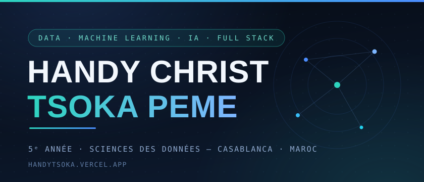
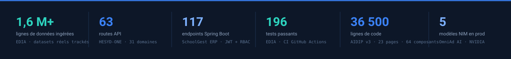
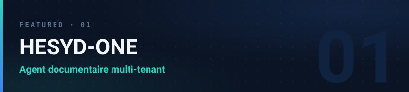
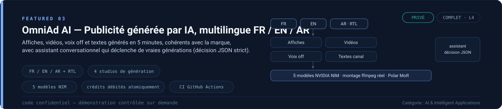
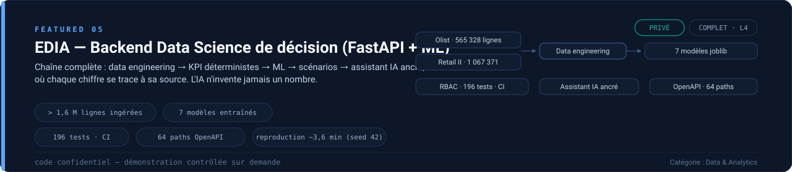
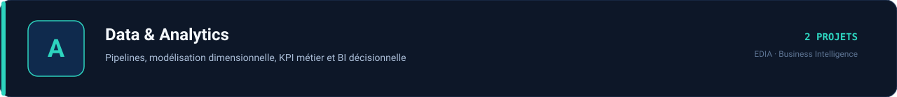
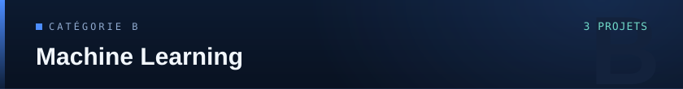
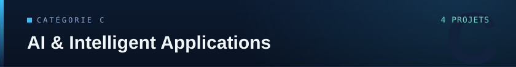
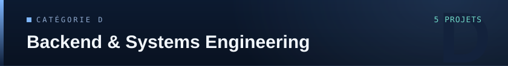
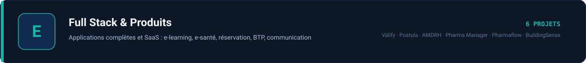

 

> Étudiant ingénieur en 5ᵉ année (Sciences des Données), Casablanca. Je conçois et réalise des systèmes complets :
> pipelines de données et modèles ML, plateformes SaaS multi-tenant, backends Spring Boot,
> applications IA en production. **Chaque projet de ce portfolio a été audité dans son code réel** —
> les indicateurs avancés sont vérifiables dans les dépôts, les notebooks ou la documentation.

**Légende des statuts** — `PROD` déployé/production · `COMPLET` terminé, testé · `DEV` développement actif · `PROTO` prototype/recherche · `RECHERCHE` travaux d'implémentation académique.
**Légende de visibilité** — `PUBLIC` code source consultable · `PRIVÉ` code confidentiel, fiche de présentation seulement (aucun lien exposé).
**Échelle de maturité interne** — L1 concept · L2 prototype · L3 fonctionnel · L4 complet · L5 déployé.

**Navigation** — [Featured](#featured--5-réalisations-majeures) · [A Data](#a--data--analytics) · [B ML](#b--machine-learning) · [C AI](#c--ai--intelligent-applications) · [D Backend](#d--backend--systems-engineering) · [E Full Stack](#e--full-stack--produits) · [Live](#applications-live--urls-vérifiées) · [Méthode](#méthode-de-cette-vitrine)

---

## Featured — 5 réalisations majeures

### 01 · HESYD-ONE — Agent documentaire d'archives multi-tenant

**Problème.** Les organisations reçoivent des documents par e-mail, WhatsApp et Drive, sans classification ni preuve de dépôt. L'archivage devient opaque et les questions sur les données restent sans réponse sourcée.

**Solution.** SaaS multi-tenant qui industrialise le cycle documentaire : réception multi-canal → classification → archivage **sur preuve** (hachage SHA-256 revérifié) → questions-réponses **sourcées** avec agent IA → livrables PDF / Excel / Word.

**KPI vérifiés dans le code :**
- **63 routes API** (31 domaines) · **39 modèles Prisma** · **36 modules `lib/`**
- **14 outils d'agent IA typés** · **185 fichiers TS/TSX (~30 900 LOC)**
- MFA **TOTP RFC 6238** · Google OAuth 2.0 **+ PKCE (S256)** · webhooks Polar vérifiés en `timingSafeEqual`
- **Test d'isolation inter-organisations exécuté** (documenté dans `docs/AUDIT.md`)

**Stack :** Next.js 16 · React 19 · Prisma 6 (SQLite dev / PostgreSQL + pgvector prod) · z-ai-web-dev-sdk (chat + ASR) · Azure AI Foundry · Google Document AI · Polar · WhatsApp Cloud API · n8n · Docker multi-stage + Compose.

**Preuve & déploiement :** [MonsterH-H/HESYD-ONE](https://github.com/MonsterH-H/HESYD-ONE) · déploiement VPS documenté (`docs/DEPLOIEMENT.md`, RPO 24h / RTO 8h) · site produit [hesyd.com](https://www.hesyd.com).

---

### 02 · Valify — SaaS de réservation sécurisé par engagement financier

**Problème.** Les no-shows coûtent cher aux prestataires de services ; les agendas classiques ne sécurisent pas les créneaux.

**Solution.** Plateforme multi-tenant de réservation en ligne où chaque créneau est validé par un **acompte ou une empreinte bancaire** : tunnel de réservation sans compte client, politiques de pénalité configurables, litiges et remboursements tracés, espace client passwordless.

**KPI vérifiés (code + README) :**
- **76 modèles Prisma** · **≈ 97 fichiers de routes API** (comptés via GitHub Code Search)
- Anti double-réservation **garantie en base** (contrainte d'exclusion PostgreSQL `btree_gist`)
- **9 parcours critiques E2E Playwright** + suites unitaires/intégration
- **2FA TOTP** · Google OAuth + sync Calendar · RGPD : export, anonymisation différée (`EvidenceArchive`)
- Transitions DST réellement testées (Ramadan Casablanca, fall-back New York)

**Stack :** Next.js 16 · TypeScript strict · Prisma 6 + PostgreSQL (Neon) · Polar (webhooks Svix signés) · Resend · WhatsApp · Web Push VAPID · Bun + Playwright.

**Statut documenté :** produit fonctionnel — mise en production conditionnée à la validation des intégrations live (matrice de réception `docs/FINAL_CDC_MATRIX.md`). Code confidentiel — non publié, **démonstration contrôlée sur demande**.

---

### 03 · OmniAd AI — Génération publicitaire multilingue (FR / EN / AR + RTL)

**Problème.** Produire des campagnes cohérentes multi-canaux et multilingues (arabe inclus, avec RTL) demande des compétences et des outils qu'une TPE n'a pas.

**Solution.** SaaS freemium de création publicitaire IA : affiches, vidéos, voix off et textes générés en 5 minutes, cohérents avec la marque, avec assistant conversationnel qui **déclenche de vraies générations** (décision en JSON strict, débit de crédits atomique, remboursement sur échec).

**KPI vérifiés (code + README) :**
- **4 studios de génération réels** (image multi-variantes, vidéo t2v + i2v, voix off, textes par canal)
- **5 modèles NVIDIA NIM en production** (flux.1-schnell, cosmos-predict2.5, magpie-tts, llama-3.1-nemotron-70b, llama-3.2-11b-vision) + replis vérifiés
- **i18n FR / EN / AR avec RTL complet** — parité auditée (0 écart)
- Montage **ffmpeg réel** (multi-scènes, transitions, mixage) · Polar Merchant of Record (webhooks signés, idempotence) · **CI GitHub Actions** (lint + tsc + audit i18n + build standalone) · Docker non-root + healthcheck

**Stack :** Next.js 16 · Prisma + PostgreSQL (Neon) · NextAuth v4 + Google OAuth + 2FA TOTP · UploadThing · Upstash Redis · z-ai-web-dev-sdk / NVIDIA NIM.

**Visibilité :** code confidentiel — **démonstration contrôlée sur demande**.

---

### 04 · AIDIP — BI conversationnelle pour Microsoft Fabric

**Problème.** Les utilisateurs métier ne savent pas écrire le DAX nécessaire pour interroger les modèles sémantiques Power BI — et les LLM « inventent » des chiffres s'ils ne sont pas contraints.

**Solution.** Plateforme d'analytique conversationnelle : l'utilisateur pose sa question en langage naturel, un pipeline multi-étapes **planifie** la requête DAX, l'**exécute** sur le modèle sémantique réel, **interprète** les résultats avec interdiction d'inventer des données, puis **valide** chaque affirmation contre les preuves (score de confiance déterministe, non deviné par le LLM). Exports officiels PDF / PowerPoint natif éditable / CSV.

**KPI vérifiés :**
- **v3 (publique)** : 183 fichiers · **~36 500 LOC** · 23 pages · 64 composants · **14 entités RLS** · **13 UDFs** côté serveur · pipeline NL→DAX en 7 étapes avec garde-fou anti-hallucination
- **v4 (privée)** : **18 modèles Prisma** · pipeline 4 étapes (plan → exécution multi-DAX → interprétation → validation) · **module admin de 7 pages** · exports PDF (pdf-lib, sommaire, pagination) / PPTX natif / CSV RFC 4180 · Microsoft Entra ID (NextAuth) · adaptateur de démo Contoso en mémoire · moteur de graphes SVG custom (pas de librairie lourde)

**Repo :** [MonsterH-H/aidip-generator](https://github.com/MonsterH-H/aidip-generator) (v3 publique) — itération v4 complète, code confidentiel.

---

### 05 · EDIA — Backend Data Science de décision (FastAPI + ML)

**Problème.** Les directions ont besoin de KPI, de prévisions et de détection d'anomalies **traçables** — pas de chiffres produits par une boîte noire.

**Solution.** Backend Python/FastAPI couvrant la chaîne complète : data engineering → KPI déterministes → machine learning → scénarios → assistant IA **ancré** (chaque chiffre se trace à sa source ; l'IA n'invente jamais un nombre).

**KPI vérifiés (code + README) :**
- **7 modèles entraînés livrés** (`joblib`, utilisables sans ré-entraînement)
- **2 datasets réels trackés** : Olist (565 328 lignes) + UCI Online Retail II (1 067 371 lignes) — **> 1,6 M de lignes ingérées**
- **196 tests passants** + **CI GitHub Actions** auto-suffisante (datasets dans le dépôt, `random_state=42`, reproduction déterministe ~3,6 min)
- **OpenAPI : 64 paths / 72 opérations**
- Import générique multi-datasets (CSV/XLSX, FR ou EN) · use cases : forecast, anomaly, segmentation, delivery risk
- RBAC + token inter-services · notifications Resend · stockage UploadThing

**Stack :** FastAPI · pandas · scikit-learn · Resend · UploadThing · Pytest · GitHub Actions.

**Visibilité :** code confidentiel — **démonstration contrôlée sur demande**.

---

## Catalogue complet — 20 projets, 5 catégories

### A · Data & Analytics

| Projet | Apport | KPI vérifiés | Stack | Statut |
|---|---|---|---|---|
| [**Business Intelligence — Ventes & Achats**](https://github.com/MonsterH-H/Business-Inteligence) `PUBLIC` | Modèle en étoile + ETL Power Query (M) + rapports interactifs pour direction commerciale | 29 mesures DAX · 4 relations · faits 2 540 ventes + 2 507 achats · 14 produits / 50 clients / 3 régions · 2 rapports, 4 pages, 12 visuels | Power BI · DAX · Power Query · Excel | `COMPLET` L3 |
| **EDIA** `PRIVÉ` *(fiche Featured n°05)* | Backend de décision data-driven déterministe et traçable | 7 modèles · > 1,6 M lignes · 196 tests · 64 paths API | FastAPI · scikit-learn | `COMPLET` L4 |

### B · Machine Learning

| Projet | Apport | KPI / métriques vérifiées | Stack | Statut |
|---|---|---|---|---|
| [**OncoAI PRO**](https://github.com/MonsterH-H/Cancerdetesction) `PUBLIC` | Aide au diagnostic du risque cancer : 23 paramètres cliniques → 3 niveaux, audit trail | 23 features · 3 classes · export `.pkl` **+ ONNX** · app Streamlit **7 pages** + registre SQL · métriques rapportées dans le notebook : test 1,00 / CV 1,0000 / baseline 0,3650 *(dataset public à classes séparables — revalidation documentée)* · déployé (accès protégé) | Python · Streamlit · scikit-learn · ONNX · SQLAlchemy | `COMPLET` L4 |
| [**Petola**](https://github.com/MonsterH-H/Petola) `PUBLIC` | Prédiction de production pétrolière journalière **explicable** (XAI) + scénarios | 7 paramètres de puits · **SHAP** (importance des variables) · 3 scénarios de forecast · dataset 15 641 lignes · tests pytest · déployé (accès protégé) | Python · Streamlit · scikit-learn · SHAP · Plotly | `COMPLET` L4 |
| [**MVTec — Détection d'anomalies industrielles**](https://github.com/MonsterH-H/mvtec-transistor) `PUBLIC` | Implémentation **PatchCore** (vision) pour contrôle qualité de transistors | EfficientNet-B0 (patchs 7×7×192) · memory bank ~20 000 patchs · kNN · heatmaps par patch · analyse de courbe d'apprentissage (PDF, 4 396 lignes) | Python · TensorFlow · scikit-learn · OpenCV | `RECHERCHE` L2 |

### C · AI & Intelligent Applications

| Projet | Apport | KPI vérifiés | Stack | Statut |
|---|---|---|---|---|
| [**HESYD-ONE**](https://github.com/MonsterH-H/HESYD-ONE) `PUBLIC` — *Featured 01* | Agent documentaire multi-tenant, Q&A sourcée, archivage sur preuve | *(fiche Featured n°01)* | Next.js · Prisma · z-ai SDK · Docker | `COMPLET` L4 |
| [**AIDIP**](https://github.com/MonsterH-H/aidip-generator) `PUBLIC` — *Featured 04* | BI conversationnelle Fabric, pipeline NL→DAX grounded | *(fiche Featured n°04)* | React · Azure OpenAI · Fabric SQL · RLS | `COMPLET` L4 |
| **OmniAd AI** `PRIVÉ` — *Featured 03* | Génération publicitaire multilingue FR/EN/AR (RTL) | *(fiche Featured n°03)* | Next.js · NVIDIA NIM · ffmpeg · Polar | `COMPLET` L4 |
| [**Prompt Engineering Lab**](https://github.com/MonsterH-H/prompt-engineering-lab) `PUBLIC` | Comparateur temps réel de **6 techniques de prompt** (baseline vs engineered, métriques de tokens) | 6 techniques codées (Zero/Few-Shot, CoT, Role, Structured Output, ReAct) · 5 tâches prédéfinies · comptage de tokens réel | React 19 · Vite · Claude API | `COMPLET` L3 |

### D · Backend & Systems Engineering

| Projet | Apport | KPI vérifiés | Stack | Statut |
|---|---|---|---|---|
| [**SchoolGest**](https://github.com/MonsterH-H/SchoolGest-backend) `PUBLIC` (+[frontend](https://github.com/MonsterH-H/SchoolGest-frontend)) | ERP scolaire complet : backend Spring Boot + portail Angular 19 | **117 endpoints** · **30 entités** · 20 services · 35 DTOs · JWT + refresh + RBAC · Swagger/OpenAPI · exports PDF (OpenPDF) / CSV · Docker + Compose 3 services · frontend : 64 composants, SSR, i18n AR/EN | Spring Boot 3.4.1 · JPA · Angular 19 · PostgreSQL | `COMPLET` L4 |
| **FleetOpti AI** `PRIVÉ` (+[ML public](https://github.com/MonsterH-H/fleetopti_ml)) | Backend SaaS logistique prédictive intégrant **l'inférence ONNX** des modèles entraînés | Spring Boot 3.4.1 · **ONNX Runtime 1.18 embarqué** · PostGIS (hibernate-spatial + JTS) · WebSocket + Kafka Streams · Spring AI (Mistral) · Drools · TOTP · Twilio · PDFBox + ZXing · 6 guides `doc/` · collection Postman + suite HTTP | Java 17 · Spring Security · PostgreSQL 17 | `COMPLET` L3 |
| [**ServiceDiscovery**](https://github.com/MonsterH-H/ServiceDiscovery) `PUBLIC` | Topologie microservices moderne : Eureka + Cloud Gateway + OpenFeign | 4 modules Maven · 14 endpoints · OpenFeign inter-services (`lb://`) · 1 base par service · README pédagogique (11 Ko) | Spring Boot 4.0.6 · Spring Cloud 2025.1.1 | `COMPLET` L3 |
| **E-Vignette Maroc** `PRIVÉ` (stage BITS, Casablanca) | Système de vignettes automobiles : citoyens, agents, administrateurs | 3 rôles · JWT · achat + tarifs + **PDF/QR** · signalements & audit · Swagger · Dockerfile | Spring Boot 3 · PostgreSQL | `COMPLET` L3 |
| **AlphaEngine** `PRIVÉ` | Terminal de trading **100 % réel** (aucune simulation) : adaptateurs courtier, risk gate, labo statistique | **73 routes API** · adaptateurs Binance (3 types de signature, OCO native) + Alpaca · isolation DÉMO/LIVE transport-level (40 checks) · Risk Gate déterministe · 6 stratégies · 7 méthodes de sizing · walk-forward + Monte Carlo · **214 tests unitaires TCU** · CI 6 jobs + images GHCR | Next.js 16 · Prisma · Docker · GitHub Actions | `COMPLET` L4 |

### E · Full Stack & Produits

| Projet | Apport | KPI vérifiés | Stack | Statut |
|---|---|---|---|---|
| **Valify** `PRIVÉ` — *Featured 02* | SaaS de réservation sécurisé par acompte, multi-tenant strict | *(fiche Featured n°02)* | Next.js 16 · Prisma · Polar | `COMPLET` L4 |
| **Postula** `PRIVÉ` | SaaS dual : recherche d'emploi + acquisition client, hub de communication multicanal | CV versionnés + matching explicable · CRM + pipeline 9 étapes · **hub 4 canaux** (WAHA, Meta Cloud, Email, Telegram) + inbox unifiée · consentements vérifiés · n8n (webhooks HMAC) · **1 100 tests documentés** (CI) + 19 E2E Playwright + 175 parcours E2E Python · Argon2id + HIBP · RBAC 3 rôles · 36 pages | Next.js 16 · Prisma · Polar · n8n | `DEV` L4 |
| [**Académie AMDRH**](https://github.com/MonsterH-H/amdrh-academy) `PUBLIC` | Plateforme e-learning pour arbitres de handball (partenaire FRMHB) | **80 routes API** · **31 modèles Prisma** (Neon) · 5 rôles + **40+ permissions granulaires** · certificats PDF + **vérification QR** · badges 4 niveaux · messagerie + forum + **temps réel Socket.IO** · import CSV · audit logs · **10 captures + 6 diagrammes UML + rapport de stage** dans le dépôt | Next.js 16 · Prisma · NextAuth · Socket.IO | `COMPLET` L4 |
| [**Pharma Manager**](https://github.com/MonsterH-H/pharma-manager) `PUBLIC` | Gestion de pharmacie : stock, ventes, alertes | Django 6 + DRF (JWT, Swagger) · React 19 + TanStack Query · ventes panier, annulation, **alertes stock bas**, export CSV · Docker Compose + nginx | Django · DRF · React · PostgreSQL | `PROD` L5 — **live** |
| **Pharmaflow** `PRIVÉ` (+[app mobile publique](https://github.com/MonsterH-H/pharmaflow_mobile)) | E-santé : gestion d'ordonnances pharmaceutiques au Maroc (backend + web + mobile Flutter) | Backend Spring Boot (ordonnances, pharmacies, pharmaciens, abonnements, notifications Twilio, docs `MODULE-*.md`) · app Flutter **22 écrans** (OTP, ordonnances photo + QR, pharmacies géolocalisées, FCM) · web React/Vite + nginx + Docker | Spring Boot · Flutter · React · PostgreSQL | `COMPLET` L3 |
| **BuildingSense** `PRIVÉ` | SaaS BTP tout-en-un : chantiers, budget, comptabilité, présence, rapports | **~33 routes fonctionnelles** (chantiers, budget, compta, matériaux, équipements, pointage, rapports, documents, messagerie, dashboards 3 rôles, assistant IA) · Supabase Auth + **10 RPCs** + edge function invitations · Recharts · exports jsPDF | React · Vite · Supabase | `PROD` L5 — **live** |

### F · Automation & Engineering — catégorie volontairement non alimentée

> Aucun projet n'a été retenu dans cette sélection : les candidats d'automatisation (workflows n8n, RELANCE) n'ont pas passé le critère de substance vérifiable. **Aucune catégorie n'est alimentée artificiellement.**

---

## Private & Confidential Projects

Les projets marqués `PRIVÉ` ci-dessus (Valify, OmniAd AI, EDIA, Postula, FleetOpti backend, E-Vignette, Pharmaflow, BuildingSense, AIDIP v4) sont des réalisations réelles dont le code est **délibérément confidentiel** :

- les fiches présentées se limitent à des informations **vérifiées et autorisées** ;
- **aucun lien vers un dépôt privé** n'est exposé ici ;
- aucun secret, credential, donnée métier ou code source n'est divulgué ;
- une démonstration contrôlée peut être organisée sur demande.

---

## Applications live — URLs vérifiées

| Application | Domaine | État constaté (vérification directe) |
|---|---|---|
| [buildingsense.vercel.app](https://buildingsense.vercel.app) | SaaS BTP | **LIVE** — HTTP 200, application réelle (repo privé) |
| [pharma-manager-sigma.vercel.app](https://pharma-manager-sigma.vercel.app) | Gestion pharmacie | **LIVE** — HTTP 200 ([code public](https://github.com/MonsterH-H/pharma-manager)) |
| [www.hesyd.com](https://www.hesyd.com) | Site HESYD — Data, IA & développement web | **LIVE** — HTTP 200 |
| [cancerdetesction.streamlit.app](https://cancerdetesction.streamlit.app) | OncoAI PRO (Medical AI) | Déployée — accès protégé par authentification Streamlit |
| [petoladata.streamlit.app](https://petoladata.streamlit.app) | Petola (Data Science · XAI) | Déployée — accès protégé par authentification Streamlit |

> Les URLs non vérifiées ou inactives ne sont volontairement pas listées.

---

## Technical Expertise

| Domaine | Démontré par |
|---|---|
| **Data Engineering & BI** | EDIA (> 1,6 M lignes, 7 modèles, 196 tests) · Power BI (étoile, 29 DAX) · pipelines pandas/scikit-learn |
| **Machine Learning** | Classification médicale + ONNX (OncoAI) · régression + XAI SHAP (Petola) · vision PatchCore (MVTec) · export ONNX vers Java (FleetOpti) |
| **Applications IA / LLM** | Agents à outils sourcés (HESYD-ONE) · pipeline NL→DAX grounded (AIDIP) · génération multimédia NVIDIA (OmniAd) · prompt engineering (Lab) · intégration n8n |
| **Backend & Architecture** | Spring Boot (117 endpoints SchoolGest, ONNX runtime FleetOpti) · Spring Cloud Eureka/Gateway/Feign · microservices par domaine · PostGIS, Kafka, WebSocket |
| **Sécurité** | JWT + refresh, **TOTP 2FA**, OAuth PKCE, RLS multi-tenant, webhooks HMAC timing-safe, isolation transport-level, AES-256-GCM, RGPD |
| **Full Stack & Produits** | 6 SaaS/produits complets (billing Polar, i18n RTL, temps réel Socket.IO, mobile Flutter) |
| **Qualité & Industrialisation** | CI GitHub Actions, Playwright, Pytest, TCU, audits i18n, docker-compose, healthchecks, PRA |

---

## Méthode de cette vitrine

Résultat d'un **audit complet de ~101 repositories** (contenu réel du code, structures, manifests, tests, notebooks et documentation) :

- seuls les projets apportant une valeur technique démontrable sont listés ;
- chaque KPI est **vérifiable** dans le dépôt, le notebook ou la documentation citée ;
- les contenus tiers re-uploadés, exercices et prototypes sans substance ont été écartés de la vitrine (aucun repository n'a été supprimé) ;
- les métriques invérifiables ont été volontairement retirées ;
- les diagrammes et fiches visuelles de cette page sont des **schémas d'architecture construits** (SVG vectoriels) — aucune capture d'écran n'est inventée ; les captures réelles restent dans les dépôts sources.

---

## Contact

**Handy Christ TSOKA PEME** — Casablanca, Maroc · ouvert aux opportunités (stage PFE, alternance, freelance)

[LinkedIn](https://www.linkedin.com/in/handy-christ-peme-tsoka-797329272) · [Email](mailto:handytsoka89@gmail.com) · [www.hesyd.com](https://www.hesyd.com)

