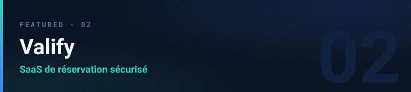
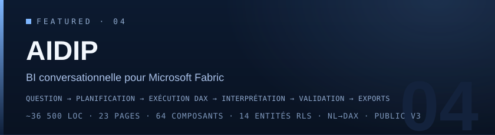

 

 

> **5ᵉ année — Sciences des Données · Casablanca.** Je construis des systèmes complets :
> pipelines de données, modèles ML traçables, backends Spring Boot, applications IA et SaaS multi-tenant.
> **Chaque indicateur de cette page est vérifié dans le code réel — rien n'est inventé.**

---

## Featured — 5 réalisations majeures

### 01 · HESYD-ONE

**Agent documentaire multi-tenant** — réception multicanal → classification IA → archivage sur preuve (SHA-256) → Q&A sourcée → livrables PDF / Excel / Word.

- **63 routes API** · 39 modèles Prisma · 14 outils d'agent IA · ~30 900 LOC
- MFA TOTP (RFC 6238) · OAuth 2.0 + PKCE · **test d'isolation inter-organisations exécuté**
- `Next.js 16` · `Prisma 6` · `z-ai SDK` · `Azure Document AI` · `Docker`

**[Voir le dépôt →](https://github.com/MonsterH-H/HESYD-ONE)**&nbsp;&nbsp;&nbsp;

---

### 02 · Valify

**SaaS de réservation sécurisé par engagement financier** — chaque créneau validé par acompte ou empreinte bancaire, multi-tenant strict.

- **76 modèles Prisma** · ~97 fichiers de routes API · anti double-réservation **garanti en base** (contrainte PostgreSQL)
- 9 parcours critiques E2E Playwright · 2FA TOTP · RGPD (export, anonymisation différée)
- `Next.js 16` · `Prisma 6 + PostgreSQL` · `Polar` · `Playwright`

&nbsp;&nbsp;*Code confidentiel — démonstration contrôlée sur demande.*

---

### 03 · OmniAd AI

**Génération publicitaire multilingue (FR / EN / AR + RTL)** — affiches, vidéos, voix off et textes générés en 5 minutes, cohérents avec la marque.

- **4 studios de génération réels** · **5 modèles NVIDIA NIM en production** + replis vérifiés
- i18n FR / EN / AR avec RTL complet — parité auditée (0 écart) · montage **ffmpeg réel** · Polar Merchant of Record
- `Next.js 16` · `NVIDIA NIM` · `ffmpeg` · `Polar` · `Upstash Redis`

&nbsp;&nbsp;*Code confidentiel — démonstration contrôlée sur demande.*

---

### 04 · AIDIP

**BI conversationnelle pour Microsoft Fabric** — langage naturel → DAX exécuté sur le modèle réel, avec garde-fou anti-hallucination.

- v3 publique : **~36 500 LOC** · 23 pages · 64 composants · **14 entités RLS** · pipeline NL→DAX en 7 étapes
- v4 : exports PDF / PPTX natif / CSV · Microsoft Entra ID · 18 modèles Prisma · moteur de graphes SVG custom
- `React` · `Azure OpenAI` · `Fabric SQL` · `RLS`

**[Voir le dépôt →](https://github.com/MonsterH-H/aidip-generator)**&nbsp;&nbsp;&nbsp;

---

### 05 · EDIA

**Backend data science de décision (FastAPI + ML)** — KPI déterministes, prévisions, détection d'anomalies ; l'assistant IA est ancré : chaque chiffre se trace à sa source.

- **7 modèles entraînés livrés** (`joblib`) · **> 1,6 M de lignes ingérées** (Olist + UCI Retail II)
- **196 tests passants** + CI auto-suffisante · OpenAPI : 64 paths / 72 opérations
- `FastAPI` · `pandas` · `scikit-learn` · `Pytest` · `GitHub Actions`

&nbsp;&nbsp;*Code confidentiel — démonstration contrôlée sur demande.*

---

## Ce que je fais — 6 domaines

---

## Catalogue — par domaine

### A · Data & Analytics

**[Business Intelligence — Ventes & Achats](https://github.com/MonsterH-H/Business-Inteligence)** — modèle en étoile + ETL Power Query : 29 mesures DAX, 4 relations, faits 2 540 ventes + 2 507 achats, 2 rapports directionnels.  
`Power BI` · `DAX` · `Power Query` &nbsp;&nbsp;&nbsp;

**EDIA** — *(Featured 05)* backend de décision déterministe et traçable : 7 modèles, > 1,6 M lignes, 196 tests.  
`FastAPI` · `scikit-learn` &nbsp;&nbsp;&nbsp;

### B · Machine Learning

**[OncoAI PRO](https://github.com/MonsterH-H/Cancerdetesction)** — aide au diagnostic du risque cancer : 23 paramètres cliniques → 3 niveaux, audit trail, export `.pkl` + ONNX, app Streamlit 7 pages.  
`Python` · `Streamlit` · `scikit-learn` · `ONNX` &nbsp;&nbsp;&nbsp;

**[Petola](https://github.com/MonsterH-H/Petola)** — prédiction de production pétrolière **explicable** (SHAP) + 3 scénarios de forecast ; dataset 15 641 lignes, tests pytest.  
`Python` · `Streamlit` · `SHAP` · `Plotly` &nbsp;&nbsp;&nbsp;

**[MVTec — anomalies industrielles](https://github.com/MonsterH-H/mvtec-transistor)** — implémentation **PatchCore** pour contrôle qualité de transistors : EfficientNet-B0, memory bank ~20 000 patchs, heatmaps par patch.  
`TensorFlow` · `OpenCV` · `scikit-learn` &nbsp;&nbsp;&nbsp;

### C · AI & Intelligent Applications

**[HESYD-ONE](https://github.com/MonsterH-H/HESYD-ONE)** — *(Featured 01)* agent documentaire multi-tenant, Q&A sourcée, archivage sur preuve.  
`Next.js` · `Prisma` · `z-ai SDK` · `Docker` &nbsp;&nbsp;&nbsp;

**[AIDIP](https://github.com/MonsterH-H/aidip-generator)** — *(Featured 04)* BI conversationnelle Fabric, pipeline NL→DAX grounded.  
`React` · `Azure OpenAI` · `Fabric SQL` &nbsp;&nbsp;&nbsp;

**OmniAd AI** — *(Featured 03)* génération publicitaire multilingue FR / EN / AR (RTL).  
`Next.js` · `NVIDIA NIM` · `ffmpeg` &nbsp;&nbsp;&nbsp;

**[Prompt Engineering Lab](https://github.com/MonsterH-H/prompt-engineering-lab)** — comparateur temps réel de 6 techniques de prompt (baseline vs engineered, métriques de tokens réels).  
`React 19` · `Vite` · `Claude API` &nbsp;&nbsp;&nbsp;

### D · Backend & Systems Engineering

**[SchoolGest](https://github.com/MonsterH-H/SchoolGest-backend)** — ERP scolaire complet : **117 endpoints**, 30 entités, JWT + refresh + RBAC ; portail Angular 19 (64 composants, i18n AR/EN).  
`Spring Boot 3.4` · `Angular 19` · `PostgreSQL` &nbsp;&nbsp;&nbsp;

**FleetOpti AI** — logistique prédictive : **ONNX Runtime 1.18 embarqué** dans Spring Boot, PostGIS, Kafka Streams, WebSocket. *(ML public : [fleetopti_ml](https://github.com/MonsterH-H/fleetopti_ml))*  
`Java 17` · `Spring Security` · `ONNX` &nbsp;&nbsp;&nbsp;

**[ServiceDiscovery](https://github.com/MonsterH-H/ServiceDiscovery)** — topologie microservices moderne : Eureka + Cloud Gateway + OpenFeign, 4 modules Maven, 1 base par service.  
`Spring Boot` · `Spring Cloud` &nbsp;&nbsp;&nbsp;

**E-Vignette Maroc** *(stage BITS, Casablanca)* — système de vignettes automobiles : 3 rôles, JWT, achat + tarifs + PDF/QR, signalements & audit.  
`Spring Boot 3` · `PostgreSQL` &nbsp;&nbsp;&nbsp;

**AlphaEngine** — terminal de trading **100 % réel** : **73 routes API**, adaptateurs Binance + Alpaca, risk gate déterministe, **214 tests unitaires**, CI 6 jobs.  
`Next.js 16` · `Prisma` · `GitHub Actions` &nbsp;&nbsp;&nbsp;

### E · Full Stack & Produits

**Valify** — *(Featured 02)* réservation sécurisée par acompte, multi-tenant strict.  
`Next.js 16` · `Prisma` · `Polar` &nbsp;&nbsp;&nbsp;

**Postula** — SaaS dual recherche d'emploi + acquisition client : CV versionnés, CRM 9 étapes, **hub 4 canaux** (WhatsApp, Meta, Email, Telegram), 1 100 tests CI.  
`Next.js 16` · `Prisma` · `n8n` &nbsp;&nbsp;&nbsp;

**[Académie AMDRH](https://github.com/MonsterH-H/amdrh-academy)** — plateforme e-learning pour arbitres de handball : 72 routes, 40+ permissions granulaires, temps réel Socket.IO, certificats PDF + QR.  
`Next.js 16` · `Prisma` · `Socket.IO` &nbsp;&nbsp;&nbsp;

**[Pharma Manager](https://github.com/MonsterH-H/pharma-manager)** — gestion de pharmacie : stock, ventes panier, alertes stock bas, export CSV.  
`Django` · `DRF` · `React 19` &nbsp;&nbsp;&nbsp;&nbsp;**live**

**Pharmaflow** — e-santé ordonnances au Maroc : backend Spring Boot + app Flutter **22 écrans** (OTP, ordonnances photo + QR, pharmacies géolocalisées). *(Mobile public : [pharmaflow_mobile](https://github.com/MonsterH-H/pharmaflow_mobile))*  
`Spring Boot` · `Flutter` · `React` &nbsp;&nbsp;&nbsp;

**BuildingSense** — SaaS BTP tout-en-un : chantiers, budget, comptabilité, pointage, rapports, assistant IA.  
`React` · `Vite` · `Supabase` &nbsp;&nbsp;&nbsp;&nbsp;**live**

### F · Automation & Engineering

> **Volontairement vide.** Aucun projet ne passe le critère de substance vérifiable — aucune catégorie alimentée artificiellement.

---

## Applications live — URLs vérifiées

- **[buildingsense.vercel.app](https://buildingsense.vercel.app)** — SaaS BTP — **LIVE** (HTTP 200)
- **[pharma-manager-sigma.vercel.app](https://pharma-manager-sigma.vercel.app)** — gestion pharmacie — **LIVE** (HTTP 200) — [code public](https://github.com/MonsterH-H/pharma-manager)
- **[OncoAI PRO](https://cancerdetesction.streamlit.app)** — déployée, accès protégé
- **[Petola](https://petoladata.streamlit.app)** — déployée, accès protégé

> Les URLs non vérifiées ou inactives ne sont volontairement pas listées.

---

## Confidentialité

Les projets `PRIVÉ` sont des réalisations réelles au code **délibérément confidentiel** :

- fiches limitées aux informations **vérifiées et autorisées** — aucun dépôt privé exposé ;
- aucun secret, credential ou donnée métier divulgué ;
- **démonstration contrôlée sur demande.**

---

## Méthode

Sélection issue d'un **audit d'environ 101 dépôts** (code réel, tests, notebooks, documentation) : seuls les projets à valeur technique démontrable sont listés ; les métriques invérifiables ont été retirées. Les bannières de cette page sont des schémas construits (SVG) — aucune capture inventée.

---

## Contact

**Handy Christ TSOKA PEME** — Casablanca · ouvert aux opportunités (stage PFE, alternance, freelance)

 

